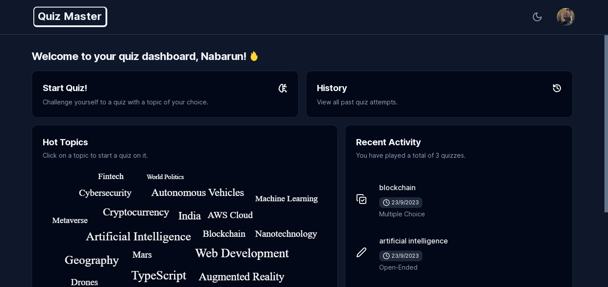

# Quiz Master

Quiz Master creates custom quizzes on any topic, making it easy to test your knowledge, learn something new, or challenge your friends. <em>Pick a topic, generate a quiz, and see how much you know.</em>

## Screenshot



<p align="center">
  <a href="https://quiz.nabarun.app"><strong>View Project »</strong></a>
</p>

## Running Locally

This application requires Node.js v24+.

### Cloning the repository to the local machine:

```bash
git clone https://github.com/nabarvn/quiz-master.git
cd quiz-master
```

### Installing the dependencies:

```bash
npm install
```

### Setting up the `.env` file:

```bash
cp .env.example .env
```

> [!IMPORTANT]
> Ensure you populate the variables with your respective API keys and configuration values before proceeding.

### Configuring Prisma:

```bash
npx prisma generate
```

```bash
npx prisma db push
```

### Running the application:

```bash
npm run dev
```

## Tech Stack

- **Language**: [TypeScript](https://www.typescriptlang.org)
- **Framework**: [Next.js](https://nextjs.org)
- **Styling**: [Tailwind CSS](https://tailwindcss.com)
- **Analytics**: [Vercel Analytics](https://vercel.com/analytics)
- **State Management**: [React Query](https://www.npmjs.com/package/@tanstack/react-query)
- **ORM Toolkit**: [Prisma](https://www.prisma.io/docs/concepts/overview/what-is-prisma)
- **LLM Provider**: [OpenAI](https://platform.openai.com/docs/introduction)
- **Postgres Database**: [Neon](https://neon.tech/docs/introduction/about)
- **Authentication**: [NextAuth.js](https://next-auth.js.org/getting-started/introduction)
- **Deployment**: [Vercel](https://vercel.com)

## Credits

This project is highly inspired from one of Elliott Chong's awesome builds. His work is really dope!

<hr />

<div align="center">Don't forget to leave a STAR 🌟</div>
